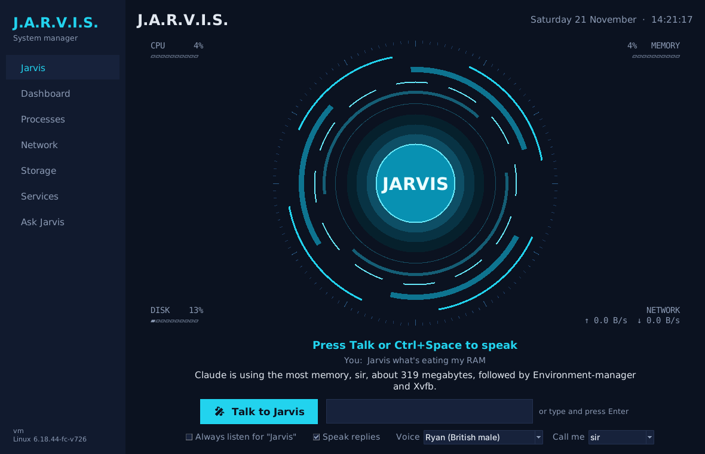

# J.A.R.V.I.S.

A voice assistant that looks after your computer. Talk to it, and it answers in a British
male voice with a calm, polite manner ("All systems are running normally, sir."). It checks
your system's health, finds what's slowing things down, closes programs, checks the network,
clears temporary files, opens apps and websites, and more. Works on Windows, macOS and Linux.



## Get it (no Python needed)

1. Open the repository's **Actions** tab on GitHub and click the latest **Build Jarvis apps** run.
2. Scroll to **Artifacts** and download the one for your computer:
   - **Jarvis-Windows**: unzip it and double-click `Jarvis.exe`. If Windows shows
     "Windows protected your PC", click **More info** then **Run anyway** (the app isn't
     code-signed, so Windows doesn't recognise it yet).
   - **Jarvis-macOS**: unzip it, then **right-click `Jarvis.app` → Open** the first time
     (macOS blocks unsigned apps on a normal double-click). Allow microphone access when asked.
   - **Jarvis-Linux**: unzip it, then run `chmod +x Jarvis-Linux` and `./Jarvis-Linux`.
     Speech needs the PortAudio library (`sudo apt install libportaudio2`).

## Talking to Jarvis

Press **Talk to Jarvis** (or Ctrl+Space) and speak, or tick **Always listen for "Jarvis"**
and just say "Jarvis, …". You can also type into the box. Things to try:

| Say | What happens |
| --- | --- |
| "How's my system?" | Processor, memory, disk and battery, with a warning if anything is running hot |
| "What's eating my RAM?" / "What's using the CPU?" | The programs using the most |
| "Is Chrome running?" / "Close Chrome" | Checks for a program, or closes it (asks you first) |
| "Am I online?" / "Open ports" | Internet check and local address; open ports and what's reachable from outside |
| "How much disk space do I have?" / "Clean up temp files" | Free space; clears old temporary files (asks first) |
| "Open YouTube" / "Open Notepad" / "Search for flights to London" | Opens websites and apps, searches the web |
| "What time is it?" / "What's the date?" | Time and date |
| "Lock the computer" / "Restart the computer" / "Shut down" | Power controls (restart and shut down ask first) |
| "Save a system report" | Saves a full snapshot to your desktop |

When Jarvis needs your permission it asks out loud; answer "yes" or "no". You can change the voice
(Ryan or Thomas, both British male) and what Jarvis calls you (sir, ma'am, boss or your own choice)
at the bottom of the screen.

The other pages give you the same controls with buttons: a live **Dashboard**, a **Processes** list
with End process, **Network**, **Storage** (biggest files and temp-file cleanup), **Services**, and
**Ask Jarvis** for typed requests and full command output.

**Internet needed for voice.** The natural British voice and speech recognition use online
services (Microsoft's neural voices and Google's speech recognition). Without internet,
Jarvis falls back to your computer's built-in voice and you can still type requests.
Some tasks (open ports on macOS, starting/stopping services, closing system programs) need
Jarvis to be run as administrator.

## Run from source

```bash
pip install -r requirements.txt
python jarvis_gui.py
```

There is also a terminal version: `python jarvis.py` (add `--voice` to hear replies), or
single commands like `python jarvis.py status`, `top mem`, `ports`, `clean --apply`.

| File | What it is |
| --- | --- |
| `jarvis_gui.py` | The desktop app |
| `assistant.py` | Jarvis's personality: understands requests and phrases the replies |
| `voice.py` | British voice (speaking) and microphone + speech recognition (listening) |
| `jarvis.py` | System commands and the terminal version |
